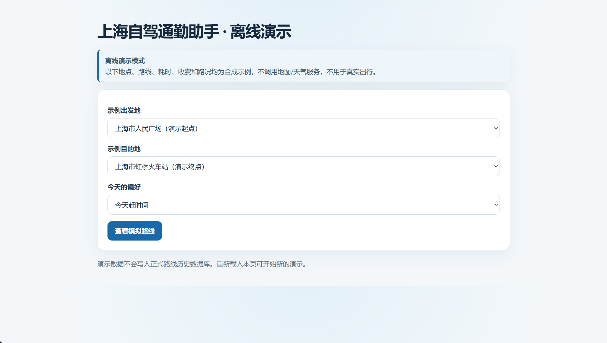
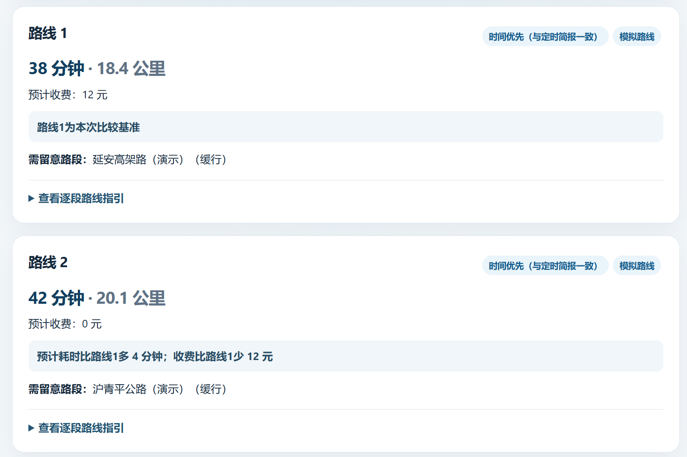

# Commute Assistant

一个面向上海自驾通勤场景的 Python 原型。它可以查询驾车路线与查询时路况、显示路线之间的预计耗时和收费差异、搜索周边设施，并生成本地通勤简报。

项目使用高德 Web 服务查询地点、路线和 POI；天气简报使用 Open-Meteo；OpenAI API 可选用于生成文字摘要。地图服务给出的路线耗时和路况代表查询时刻，不是实际行程记录，也不是未来实时路况预测。

## 功能

- 比较高德返回的最多三条驾车路线，包括预计耗时、距离、收费和查询时路况。
- 输入起点、目的地和途经点；地点候选可限定上海市内或指定的其他城市。
- 搜索目的地或当前位置附近的停车场、加油站、充电站、厕所、药房、便利店等设施。
- 按路线几何识别历史路径，按日期汇总地图预计值；每条路径至少需要三个不同日期才显示历史参考。
- 可选生成天气与路线简报；AI 服务不可用时使用本地规则，天气或路线单项失败时尽量保留另一项数据。
- 查看一份不含真实地点或密钥的[合成示例报告](./commute-assistant/examples/demo_report.md)。

## 演示截图

以下页面来自不联网的离线演示。地点、路线、路况、耗时和收费均为合成示例，不代表真实导航数据。

**离线演示入口**



**路线比较结果**



## 环境与验证范围

- 已验证环境：Windows PowerShell、Python 3.15.0。
- 在上述环境中，`commute-assistant/verify_task2.py` 的 7 项离线行为检查全部通过。
- 检查使用合成数据，不调用地图、天气或 OpenAI 服务；尚未据此验证全新电脑安装流程、真实 API 权限或真实通勤预测效果。

## 无 Key 离线演示

可以先在本机运行一份完全离线的网页演示，不需要配置 Key，也不会访问地图、天气或 OpenAI 服务，不会写入真实历史数据库：

```powershell
cd .\commute-assistant
& .\.venv\Scripts\python.exe .\commute_web.py --demo
```

浏览器会打开 `http://localhost:8766`。页面里的地点、路线、路况、耗时和收费都是合成示例，只用于展示交互流程，不用于真实出行。按 `Ctrl+C` 停止。

项目原理见[数据流程说明](./commute-assistant/docs/data-flow.md)，常见启动问题见[排错记录](./commute-assistant/docs/troubleshooting.md)。

## 安装

在 PowerShell 中从仓库根目录运行：

```powershell
cd .\commute-assistant
py -3.15 -m venv .venv
& .\.venv\Scripts\python.exe -m pip install -r .\requirements.txt
Copy-Item .\commute_config.example.json .\commute_config.json
```

若电脑没有 Python 3.15，请安装 Python 3.15，或把 `py -3.15` 改成电脑上已安装的 Python 版本命令。依赖安装与首次运行流程仍需在新电脑上实际确认。

## 配置 Key

按需在当前 PowerShell 窗口设置 Key。不要把真实 Key 写入代码、配置文件、截图或 Git 提交：

```powershell
$env:AMAP_WEB_KEY = "你的高德 Web 服务 Key"
$env:OPENAI_API_KEY = "你的 OpenAI API Key"
```

高德 Key 用于地点、路线和 POI 查询；OpenAI Key 只用于 AI 简报。没有 OpenAI Key 时会尝试使用本地规则生成摘要。API 调用可能产生费用，请在对应服务平台确认账户额度和计费情况。

编辑 `commute_config.json` 设置天气查询位置、通勤时段和定时简报路线。示例配置不含 Key。真实配置、报告、历史数据库和加密 Key 已由 `.gitignore` 排除。

## 运行

生成一次天气与路线报告：

```powershell
& .\.venv\Scripts\python.exe .\commute_assistant.py
```

报告保存在 `commute_reports`。

启动交互网页：

```powershell
& .\.venv\Scripts\python.exe .\commute_web.py
```

在本机浏览器打开 `http://localhost:8765`。浏览器定位需要用户授权；手机使用定位还要求 HTTPS 等安全上下文。开发服务器监听本机网络接口，建议只在可信私人网络中使用，不要直接暴露到互联网。按 `Ctrl+C` 停止。

每天 08:00 和 18:00 自动生成报告是可选功能，需要 Windows 计划任务、电脑届时开机且当前用户已登录。可运行 `commute-assistant/setup_commute_schedule.ps1` 设置；Key 会使用当前 Windows 账户加密保存在本地。

## 离线验证

从 `commute-assistant` 项目目录运行：

```powershell
& .\.venv\Scripts\python.exe .\verify_task2.py
```

脚本使用临时数据库、临时报告和模拟服务，不需要 Key 或联网。预期显示 `Ran 7 tests` 和 `OK`。覆盖历史统计、服务降级、无可用路线提示以及失败诊断报告。

## 数据含义与限制

- 路线耗时、距离、收费和路况是高德查询时返回的地图数据；程序没有记录车辆真实出发/到达时间。
- 未来时间页面统计的是本机保存的历史地图预计值，不是未来实时路况预测。三个日期只是程序门槛，不代表预测可靠。
- 历史记录保存在本机 `commute_history.sqlite3`。旧记录没有路线几何，不能可靠对应路线，不会混入新的按路线估算。
- 事故、施工、天气和交通管制可能改变实际行程；出发前请以实时导航为准。
- 详细配置和使用说明见 [`commute-assistant/README.md`](./commute-assistant/README.md)。
